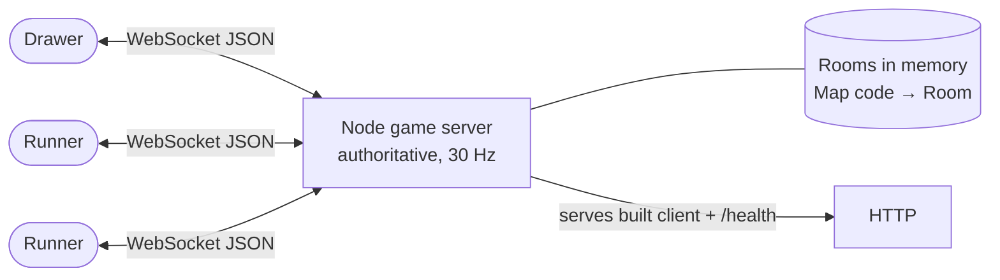

# Inkfall: High-Level Design

A real-time multiplayer browser game: each round one player is the drawer and has 45 seconds to draw platforms and spikes over a pit, while everyone else runs through the level as it is being drawn. Runners score by escaping; the drawer scores for every runner who falls, but scores nothing if nobody escapes. For code-level detail see the [Low-Level Design](lld.md).

## 1. System context

## 2. Architecture

| Part | Responsibility |
|---|---|
| `shared/` | Code run identically on client and server: constants, geometry, stroke rules, runner physics (`stepRunner`), protocol types |
| `server/` | HTTP + WebSocket server, room lifecycle, round phases, ink validation, kill checks, scoring |
| `client/` | Canvas rendering, input, prediction and reconciliation, pen tools, synthesized sound |
| `tests/sim.test.ts` | Deterministic checks of the core rules using the shared simulation |

## 3. Netcode summary

| Aspect | Design |
|---|---|
| Authority | Server owns every position, the ink budget and kill checks; clients only send inputs |
| Rates | 30 Hz simulation tick, 20 Hz snapshots, 15 Hz drawer cursor |
| Own runner | Client-side prediction + replay of unacknowledged inputs; errors under 90 px smoothed as a visual offset |
| Other runners | Interpolated one snapshot behind |
| Pen | Drawer draws locally with zero latency; strokes are relayed to everyone else; full board resync every 5 s |
| Reconnect | Seat, score, colour and turn kept for 45 s; identity in `sessionStorage` so a second tab can't steal it |

## 4. Game rules that matter

| Rule | Why |
|---|---|
| Nobody escapes → drawer scores zero | Stops the "just build a wall" strategy |
| Erasing refunds ink | Makes bait-and-switch bridges affordable |
| Spikes cost 2.2× ink, none within 46 px of spawn | Rations cruelty, prevents spawn-camping |
| Runners respawn after 1.6 s; escape once per round | Keeps pressure on the drawer all round |
| Empty board after prep → server lays a plain bridge | An idle drawer can't stall the round |

## 5. Tech

| Item | Choice |
|---|---|
| Language | TypeScript everywhere |
| Server | Node.js 22, `ws`, run with `tsx` |
| Client | Vite, Canvas 2D, Web Audio |
| Deploy | Render (`render.yaml`, free web service, `/health` check) |
