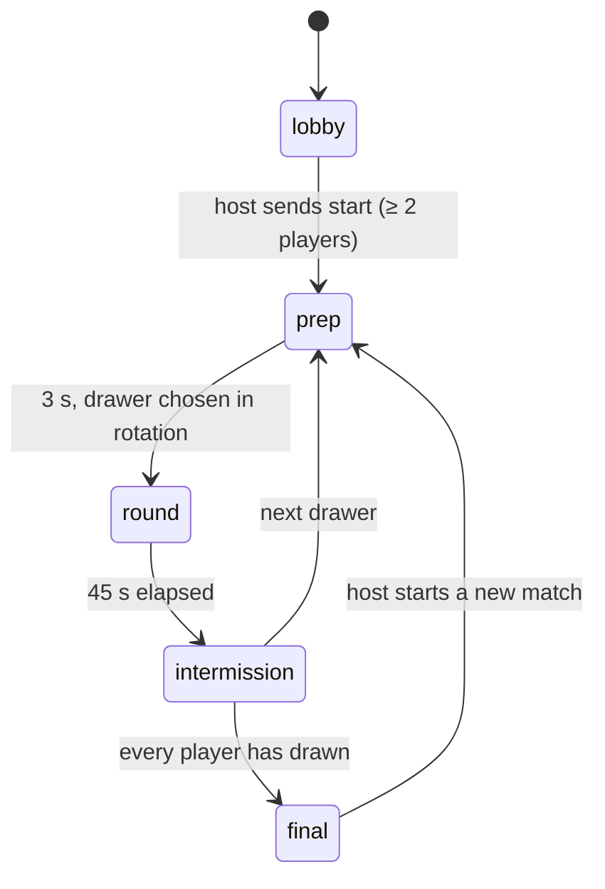
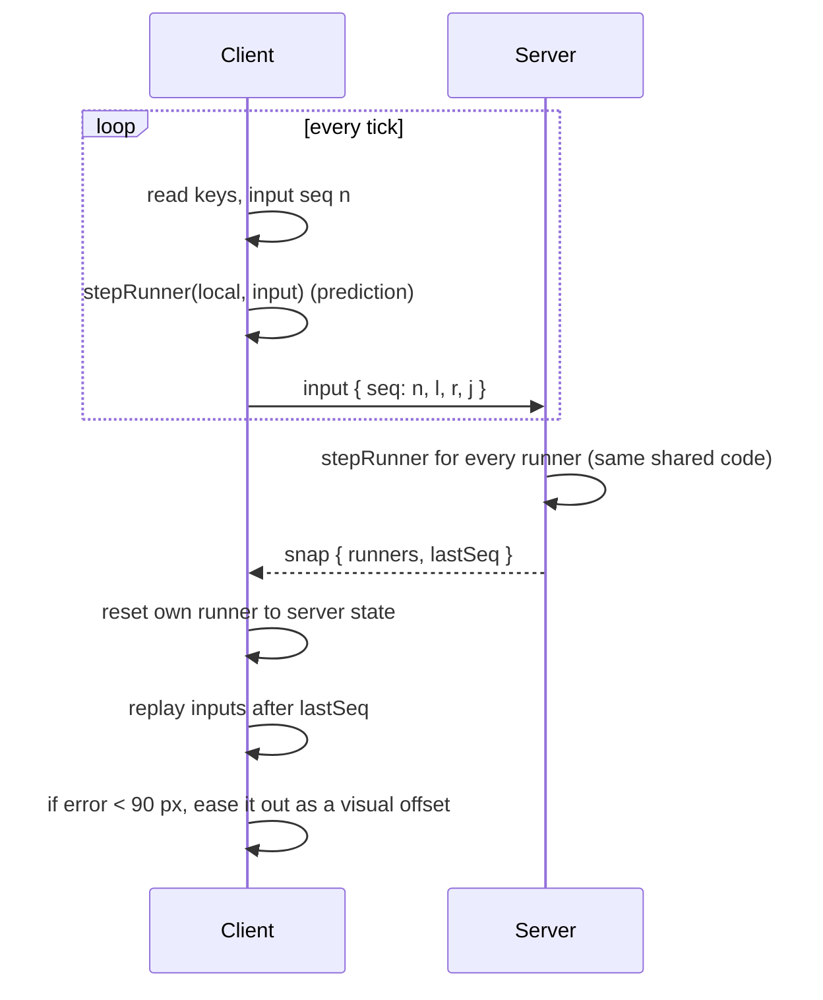

# Inkfall: Low-Level Design

For the big picture see the [High-Level Design](hld.md).

## 1. Key constants (`shared/src/constants.ts`)

| Constant | Value |
|---|---|
| World | 960 × 520; ledge x 0–128, exit x 828–960 at y 362; fall line y 486 |
| Timing | `TICK_HZ` 30 (4 physics substeps), `SNAPSHOT_HZ` 20, `CURSOR_HZ` 15 |
| Runner | radius 9, run 150 px/s, gravity 1500, jump −540, max fall 700, coyote and jump buffer 5 ticks |
| Ink | budget 1100, line 1.0 per px, spike 2.2 per px, erase radius 22, max 4000 points per room |
| Rounds | prep 3 s, round 45 s, intermission 6 s, 2–8 players |
| Scoring | 100 per runner downed (drawer), 300 clean round, 400 escape, +100 first out |

## 2. Room phases

## 3. Protocol (`shared/src/protocol.ts`)

| Client → server | Purpose |
|---|---|
| `join { room, name, pid? }` | Join or rejoin (pid from `sessionStorage`) |
| `input { seq, l, r, j }` | Left / right / jump for one tick |
| `pen begin / point / end / erase` | Drawer strokes (`ink` or `spike`) and erasing |
| `cursor { x, y, tool }` | Drawer cursor position |
| `start`, `ping` | Start the game; latency |

| Server → client | Purpose |
|---|---|
| `welcome`, `lobby` | Identity, room code, tick rate; player list and host |
| `phase` | Phase, drawer, round index / total, time left |
| `board` | Full stroke list and ink used (resync) |
| `penBegin / penPoint / penEnd / penErase` | Relayed strokes with updated ink |
| `snap { tick, runners }` | Authoritative runner states (with last processed input seq) |
| `cursor`, `fx`, `scores`, `toast`, `pong` | Drawer cursor, down / out effects, round results, messages |

## 4. Prediction and reconciliation

After 10 ticks with no input (for example a background tab), the server treats the player as idle instead of repeating their last input.

## 5. Shared code

| Module | Exports |
|---|---|
| `runner.ts` | `createRunner`, `respawn`, `stepRunner(r, input, segs)`, `markDown`, `markOut` |
| `strokes.ts` | Stroke types (`ink`, `spike`), validation, `costOf(kind)` |
| `geom.ts` | `dist`, `closestOnSeg`, `segsIntersect`, `polyLength`, `clamp` |
| `protocol.ts` | Message types, `encode`, `decode` |

## 6. Scripts

| Command | Runs |
|---|---|
| `npm run dev` | Server (`tsx watch`) and client (Vite) together |
| `npm run build` | Client build |
| `npm start` | Server (Render sets `GAME_PORT=$PORT`) |
| `npm test` | Deterministic rule tests |
